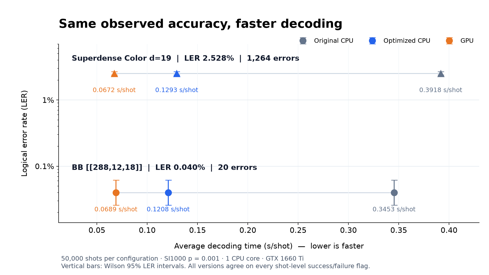

# Tesseract: optimized CPU and exact GPU decoding

This project builds on the original [Tesseract quantum error-correction decoder](https://github.com/quantumlib/tesseract-decoder), introduced in **Tesseract: A Search-Based Decoder for Quantum Error Correction**. Its goal is to accelerate decoding on both CPUs and NVIDIA GPUs while preserving the original decoder's results under the same decoding configuration. Correctness is the constraint throughout the optimization: speed gains must not come from reducing the search budget, changing the beam, weakening state comparisons, or accepting less accurate predictions.

Tesseract searches for an explanation of the observed detector events in a detector error model. On medium and large codes, much of its runtime comes from repeatedly updating search states, evaluating detector costs and managing the search frontier. This repository provides an optimized C++ CPU implementation and a Python-hosted CUDA implementation that reduce this work and reuse preparation across many shots. The archived original CPU implementation is also included for reproducible comparisons.

The CPU implementation reuses calculations between related search states, stores the frontier more compactly and shares model preparation across shots. The GPU implementation keeps the model and workspace resident on the device, processes batches of shots and distributes expensive detector calculations across cooperating threads while retaining ordered search decisions. Guarded paths and live exact CPU replay handle cases that cannot safely use the accelerated GPU path.

The release includes installation instructions, both optimized implementations, compact results of six large-code experiments, and scripts to verify the evidence and reproduce the measurements. The preservation goal concerns decoder outputs; the published 50,000-shot experiments specifically verify logical outcomes by comparing every shot's success/failure indicator against the original CPU implementation.

**50,000 shots per configuration: 2.86–3.03× CPU speedup and 5.01–5.83× GPU speedup over the archived original CPU implementation. All three implementations agree on every shot-level success/failure flag.**



Lower average seconds per shot means faster decoding. The vertical axis uses a logarithmic scale; error bars show Wilson 95% intervals. Both circuits use SI1000 noise at **p = 0.001**. These are two independent decoding workloads; BB has 12 logical observables and Color has one.

## Large-code benchmark

Each configuration decodes the **same 50,000 unique shots** for its code. There are six serial experiments, totaling 300,000 measured decodings. The 64 held-out warmup shots are additional and excluded from the table.

| Code | Implementation | Average s/shot ↓ | Total decode time | Speedup vs original | Logical failures / 50,000 | LER |
|:--|:--|--:|--:|--:|--:|--:|
| BB `[[288,12,18]]` | Original CPU | 0.345341 | 4.796 h | 1.00× | 20 | 0.040% |
| BB `[[288,12,18]]` | **Optimized CPU** | **0.120848** | **1.678 h** | **2.86×** | **20** | **0.040%** |
| BB `[[288,12,18]]` | **GPU** | **0.068872** | **0.957 h** | **5.01×** | **20** | **0.040%** |
| Superdense Color `d=19` | Original CPU | 0.391756 | 5.441 h | 1.00× | 1,264 | 2.528% |
| Superdense Color `d=19` | **Optimized CPU** | **0.129315** | **1.796 h** | **3.03×** | **1,264** | **2.528%** |
| Superdense Color `d=19` | **GPU** | **0.067183** | **0.933 h** | **5.83×** | **1,264** | **2.528%** |

GPU is **1.75× faster than optimized CPU on BB** and **1.92× on Color**. For both codes, the optimized CPU and GPU each have **zero shot-level success/failure disagreements** with the original CPU on all 50,000 shared inputs. GPU fallback count was zero in both completed formal experiments.

### Measurement conditions

- CPU: AMD Ryzen 7 4800HS, **one core**; GPU: NVIDIA GTX 1660 Ti, **6 GB**, plus one host CPU core. The CPU model comes from earlier experiment metadata on the same machine.
- Original CPU source is the untouched archived Tesseract implementation. Optimized CPU and GPU use the same beam (**5**), search budget (**100,000**), identity detector order, error merging and no-revisit policy. No beam climbing or sparsification.
- BB: 288 data / 576 total qubits, 18 rounds, X memory. Color: 271 data / 541 total qubits, 19 rounds, superdense X memory. Actual detector counts are 5,184 and 5,130.
- LER counts a shot if **any logical observable** is predicted incorrectly. Empty syndromes and low-confidence outputs remain in the denominator. Low-confidence counts were 20 for BB and 2,604 for Color, identical across all implementations.
- Average s/shot = sum of completed block wall times / 50,000. Timing includes GPU transfer, synchronization and output materialization, and would include actual CPU fallback latency. Setup, warmup, result-file IO and LER calculation are excluded.
- Results were measured on Windows 11 with CPU workers in Ubuntu 24.04 / WSL2. GTX 1660 Ti results are specific to this hardware and configuration.
- The BB GPU run resumed after a host buffer-allocation error at 9,000 shots. Inputs, decoder binaries and search parameters were unchanged. Repair downtime and the failed attempt are excluded; [repair history](benchmarks/results/2026-10/repair_history.json) is included.

[Structured results](benchmarks/results/2026-10/summary.json) · [Compact block records](benchmarks/results/2026-10/) · [Input identities](benchmarks/inputs/manifest.json) · [Protocol](docs/BENCHMARK.md)

## How the acceleration works

### Optimized CPU

The complete CPU implementation is in [src/](src/), principally [tesseract.cc](src/tesseract.cc) and [batch_plan.cc](src/batch_plan.cc):

- **Reuse work between related search states.** Incremental syndrome and detector-count updates carry information between expanded parents and siblings, avoiding repeated reconstruction of the same state. Deferred child calculations avoid doing expensive work before it is needed.
- **Reduce frontier memory and comparison overhead.** Compact state storage reduces allocation and memory traffic. Guarded integer ranks accelerate repeated heuristic comparisons while preserving ordered floating-point cost updates and the original search's tie behavior.
- **Reuse model preparation across shots.** Exact certificates and model-dependent preparation are retained through a private batch owner. This amortizes setup over many independent shots without substituting cached decoding answers.

Together, these changes reduce redundant computation inside the search and repeated preparation around it. On the two published workloads, the optimized CPU takes about one third of the original CPU's measured decoding time on the same single core.

The public decoder interface is retained. Unsupported optimization cases use guarded exact paths. Upstream decoder settings remain configurable; the published benchmark uses the fixed parameters above.

### GPU

The complete Python-hosted CUDA source is in [gpu/](gpu/). Kernels are compiled at runtime with CuPy/NVRTC; no precompiled GPU binaries are required.

- **Keep reusable data on the GPU.** The detector graph and search workspace remain resident across streamed shot batches. This avoids rebuilding the model and repeatedly allocating device memory for individual shots; the host reconstructs the returned outputs.
- **Parallelize expensive calculations within a shot.** Cooperating threads in a CUDA thread block (CTA) evaluate detector-cost queries and update counts. Search and heap commits remain ordered to preserve decoding semantics.
- **Reduce device memory traffic.** Ranked and compact state layouts, checked 32-bit CSR indices and compact visited-state storage reduce the bytes moved during search. Hashes are used for lookup, with exact visited-state comparisons retained for correctness. Kernel selection accounts for the model's row widths and supported bounds.
- **Preserve exact behavior at resource limits.** Workspace overflow triggers **live exact optimized-CPU replay**. Replay time is included when it occurs; neither published formal GPU run required fallback.

These changes add a further 1.75–1.92× throughput improvement over the optimized CPU on the tested GTX 1660 Ti, bringing the total speedup over the archived original CPU to 5.01–5.83×. The gain depends on the code, shot workload and hardware.

The published BB run uses the CTA640 compact-visited/single-hash implementation. Color d=19 has wider detector rows and uses the existing **wide-state CTA256 implementation**. Its larger row width does not fit the fused decoder's 8-bit prefix field. [run_decoder.py](benchmarks/scripts/run_decoder.py) uses the appropriate guarded implementation and the corrected allocation planner.

This is a research backend for supported one-order models. The published configurations are described in the [benchmark protocol](docs/BENCHMARK.md). The table above uses measured formal runs with a live replay callback.

## Install

### CPU and benchmark workers — Linux / WSL2

Requirements: Linux x86-64, C++20 compiler, Git, Python 3.12+ and Bazel 9 / Bazelisk. Internet access is required for the first Bazel dependency fetch. The repository includes `.bazelversion`.

```bash
python3 -m venv .venv
source .venv/bin/activate
python -m pip install -r requirements-cpu.txt
bash benchmarks/scripts/build_benchmark.sh
```

This builds the **optimized CPU**, the original comparison worker and the input-only graph exporter. Run a small CPU decoding task:

```bash
python benchmarks/scripts/run_decoder.py --family bb --mode optimized --shots 128
```

For the existing C++ CLI, build `bazel build --jobs=1 //src:tesseract` and inspect `bazel-bin/src/tesseract --help`.

### GPU — Linux or Windows + WSL2

Requirements: a compatible NVIDIA driver and CUDA 12 runtime/NVRTC. The tested CuPy and CUDA component versions are pinned in [requirements-gpu.txt](requirements-gpu.txt); the 6 GB GTX 1660 Ti supported both published configurations.

On Linux, extend the environment above:

```bash
python -m pip install -r requirements-gpu.txt
python -c "import cupy as cp; print(cp.cuda.runtime.getDeviceCount())"
python benchmarks/scripts/run_decoder.py --family color --mode gpu --shots 128
```

On Windows, build the workers inside WSL2 at the same checkout location. Then install `requirements-gpu.txt` in a **native Windows Python 3.12 environment** and run the same Python command from Windows. The host uses the native GPU, and the persistent exact CPU replay worker runs in WSL. The WSL distribution name defaults to `Ubuntu-24.04` in the benchmark adapter.

For other CUDA installations, follow [CuPy's installation guide](https://docs.cupy.dev/en/stable/install.html). GPU workspace exhaustion is handled by exact CPU replay; unsupported model/backend initialization errors stop explicitly.

### Optional optimized CPU Python wheel

The Bazel Python package uses a **Python 3.13 toolchain**. To install into a Python 3.13 environment:

```bash
bazel build --jobs=1 //:tesseract_decoder_wheel \
  --define=VERSION=0.1.1 --define=ABI_TAG=cp313
python3.13 -m pip install bazel-bin/*.whl
```

This builds a local native Linux wheel. It is CPU-specific (`-march=native`); build on the machine where it will run. Installing the package from PyPI instead downloads upstream Tesseract and does not install this release's optimizations. The GPU host code is used through the source checkout.

[CPU Python interface](src/py/README.md) · [Original upstream documentation](https://github.com/quantumlib/tesseract-decoder)

## Reproduce the published workloads

The source checkout contains the two published circuits, recorded sampling seeds, input hashes and compact result evidence. Full sampled syndrome/truth arrays are not distributed. The runner regenerates inputs from each circuit with seed 202610100 (BB) or 202610101 (Color), including 64 held-out warmup shots. The graph exporter does **no reference decoding**.

Use the same input directory across implementations to compare a shared regenerated sample. Sampling can vary with software versions, so a fresh reproduction is not guaranteed to match the historical input bytes, error counts or timings exactly.

```bash
# Run all six experiments sequentially; this explicitly starts long decoding jobs.
for family in bb color; do
  for mode in gpu original optimized; do
    python benchmarks/scripts/run_decoder.py --family "$family" --mode "$mode" \
      --shots 50000 --output outputs/reproduction
  done
done
```

The published circuits and fixed p=0.001 are reused directly; circuit generation and error-rate selection are not needed. Each backend retains state across 1,000-shot blocks; completed blocks can be resumed using the same output directory. Performance depends on hardware, drivers and host/worker placement.

Audit the existing evidence or redraw the figure **without decoding**:

```bash
python benchmarks/scripts/verify_results.py
python -m pip install -r requirements-plot.txt
python benchmarks/scripts/plot_results.py
```

## Repository layout

- `src/`: optimized CPU implementation, C++/Python interfaces and CLI sources.
- `gpu/`: selected exact GPU backends and their required kernel-source dependencies.
- `benchmarks/baseline/`: archived original CPU decoder for comparisons.
- `benchmarks/scripts/`: build, run, verify and plot entry points.
- `benchmarks/circuits/`: the BB and Color circuits used in the published runs.
- `benchmarks/results/2026-10/`: summaries, compact block timings and per-shot outcome arrays.
- `benchmarks/inputs/`: historical input hashes, seeds and metadata; no bulk arrays.
- `docs/`: benchmark protocol and README figure.

Historical optimization experiments, unused kernel variants, the upstream circuit collection, tutorials and example logs are omitted. Build artifacts and regenerated bulk inputs are ignored by Git.

## License and attribution

Apache-2.0; see [LICENSE](LICENSE) and [NOTICE](NOTICE). Based on [quantumlib/tesseract-decoder](https://github.com/quantumlib/tesseract-decoder) and **Tesseract: A Search-Based Decoder for Quantum Error Correction**, [arXiv:2503.10988](https://arxiv.org/abs/2503.10988). Superdense circuits use the official [Chromobius generator](https://github.com/quantumlib/chromobius); its commit is recorded in [circuits.json](benchmarks/circuits/manifest.json).
